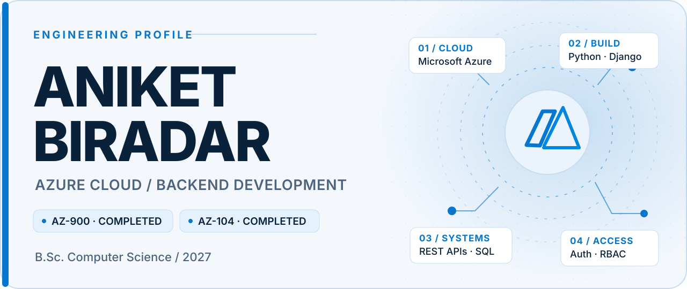
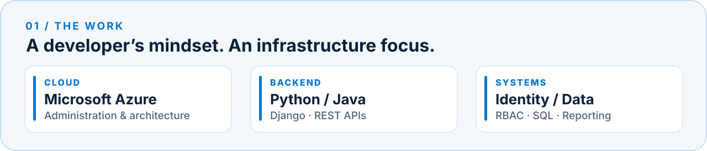
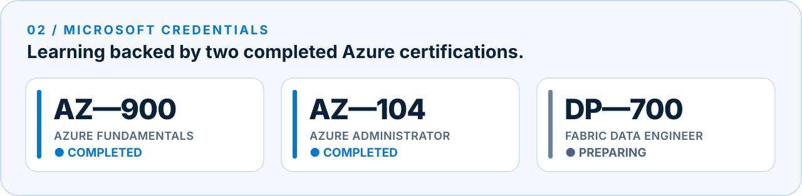
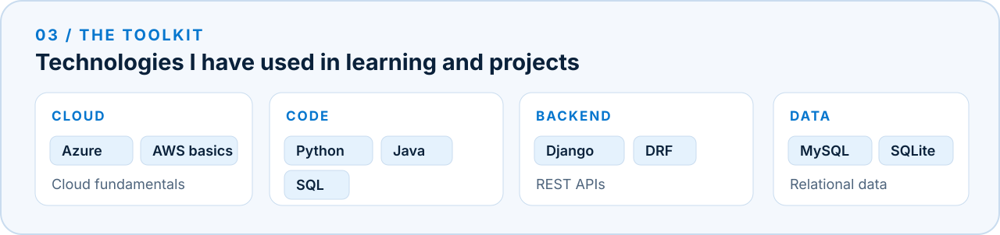
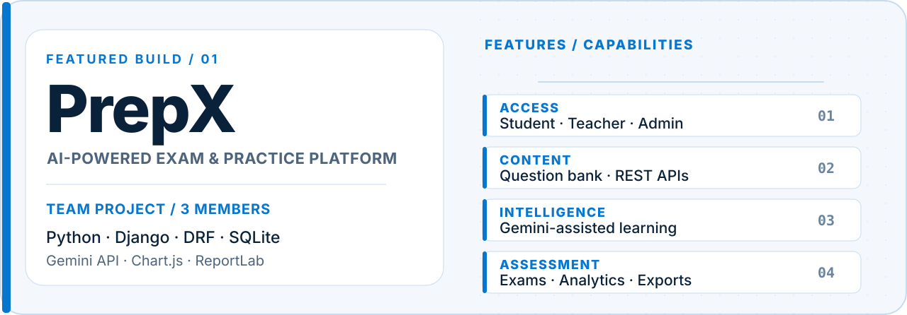
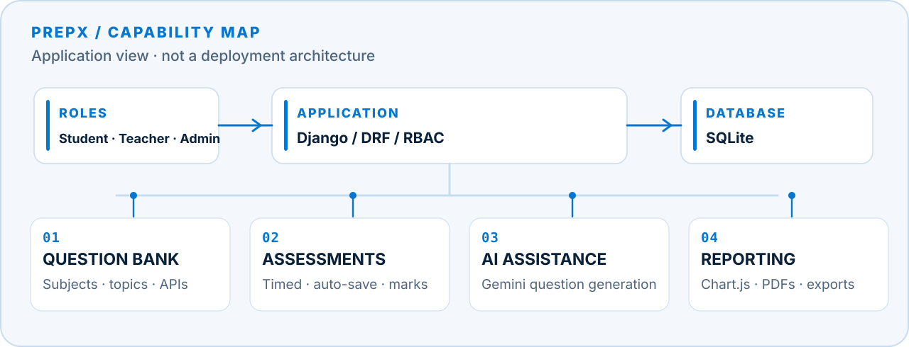
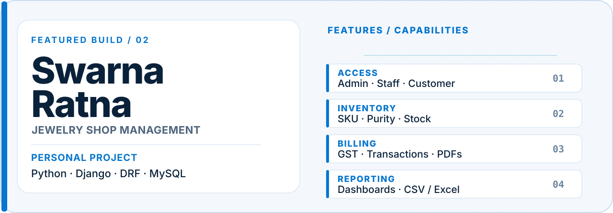
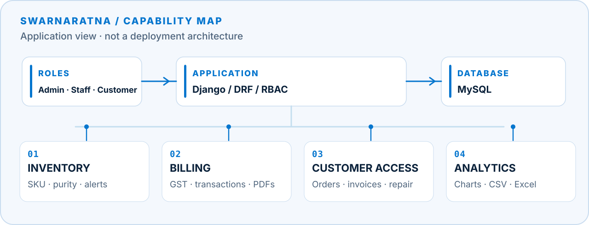
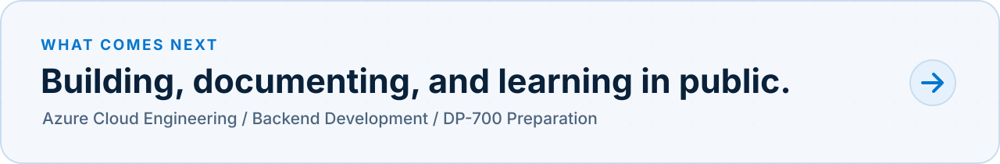

<!--
  Aniket Biradar — GitHub profile
  Repository: aniketbiradar-official/aniketbiradar-official
  Custom SVG artwork is under ./assets. Capability maps are editable in ./diagrams.
  No external counters, unverified statistics, or fabricated credential identifiers.
-->

  <picture>
    <source media="(prefers-color-scheme: dark)" srcset="./assets/studio-v2/hero-dark.svg" />
    <source media="(prefers-color-scheme: light)" srcset="./assets/studio-v2/hero-light.svg" />
    
  </picture>

  

    <a href="https://aniketbiradar.site/"><b>PORTFOLIO</b></a>
    &nbsp;&nbsp; / &nbsp;&nbsp;
    <a href="https://www.linkedin.com/in/aniket-biradar-a6b775371/"><b>LINKEDIN</b></a>
    &nbsp;&nbsp; / &nbsp;&nbsp;
    <a href="https://github.com/aniketbiradar-official"><b>GITHUB</b></a>
    &nbsp;&nbsp; / &nbsp;&nbsp;
    <a href="mailto:aniketbiradar.official@gmail.com"><b>EMAIL</b></a>
  

  Computer Science undergraduate · Class of 2027 · India

 

<picture>
  <source media="(prefers-color-scheme: dark)" srcset="./assets/studio-v2/focus-dark.svg" />
  <source media="(prefers-color-scheme: light)" srcset="./assets/studio-v2/focus-light.svg" />
  
</picture>

### About

I'm **Aniket Biradar**, a **B.Sc. Computer Science** student at **COCSIT, Latur**, graduating in **2027**. My work sits at the intersection of **backend development** and **cloud engineering**. I build and document Python- and Java-based projects, with particular interest in APIs, access control, data handling, and Azure infrastructure.

I focus on understanding how applications work end to end: **what a feature does, how its data flows, and where security and reliability matter.**

 

<picture>
  <source media="(prefers-color-scheme: dark)" srcset="./assets/studio-v2/credentials-dark.svg" />
  <source media="(prefers-color-scheme: light)" srcset="./assets/studio-v2/credentials-light.svg" />
  
</picture>

AZ-900 and AZ-104 completed · DP-700 in preparation · Verification URLs can be added when provided.

 

<picture>
  <source media="(prefers-color-scheme: dark)" srcset="./assets/studio-v2/toolkit-dark.svg" />
  <source media="(prefers-color-scheme: light)" srcset="./assets/studio-v2/toolkit-light.svg" />
  
</picture>

<b>More about my development toolkit</b>

| Area | Tools and technologies |
| :--- | :--- |
| **Cloud** | Microsoft Azure · AWS fundamentals |
| **Languages** | Python · Java · SQL |
| **Backend** | Django · Django REST Framework · REST APIs |
| **Databases** | MySQL · SQLite |
| **Libraries** | NumPy · Pandas · Tkinter · PyPDF2 |
| **Development** | Git · GitHub · VS Code · PyCharm · Postman |
| **Concepts** | Object-oriented programming · Authentication · RBAC |

*This represents learning and project experience; it does not imply advanced professional proficiency in every tool.*

---

## Selected work

Two web application projects that demonstrate application architecture, role-based access, APIs, and data-driven features.

<a href="https://github.com/PrepX-Team/PrepX">
  <picture>
    <source media="(prefers-color-scheme: dark)" srcset="./assets/studio-v2/prepx-dark.svg" />
    <source media="(prefers-color-scheme: light)" srcset="./assets/studio-v2/prepx-light.svg" />
    
  </picture>
</a>

**PrepX — AI-Powered Online Exam & Practice Platform**  
*Team project (3 members)*

A Django-based examination and practice platform with role-based access, question bank APIs, AI-assisted question generation, timed assessments, and teacher reporting.

<b>Explore PrepX engineering contributions and capability diagram</b>

- **Identity and authorization:** Implemented authentication, session management, route protection, and RBAC for **Student, Teacher, and Admin** roles.
- **Question bank APIs:** Developed Subject, Topic, and Question Bank APIs using **Django REST Framework**, including ownership controls, difficulty levels, validation, search, and filtering.
- **AI-assisted learning:** Integrated the **Gemini API** for question generation and personalized learning recommendations.
- **Practice and examinations:** Developed progressive test unlocking, timed exams, auto-save, randomization, negative marking, and auto-evaluation.
- **Teacher workflows:** Built exam management, **Chart.js** analytics, **ReportLab** certificates, and CSV/Excel exports with the Django ORM.

**Technology stack:** Python · Django · Django REST Framework · SQLite · Bootstrap · Chart.js · ReportLab · Gemini API

**Capability map:** This is an application feature map, not a claim about deployment or cloud infrastructure.

<picture>
  <source media="(prefers-color-scheme: dark)" srcset="./assets/studio-v2/prepx-map-dark.svg" />
  <source media="(prefers-color-scheme: light)" srcset="./assets/studio-v2/prepx-map-light.svg" />
  
</picture>

[**Editable draw.io source**](./diagrams/prepx-capability-map.drawio) · [**View source repository**](https://github.com/PrepX-Team/PrepX)

<a href="https://github.com/PrepX-Team/PrepX"><b>EXPLORE PREPX ↗</b></a>

 

<a href="https://github.com/aniketbiradar-official/jewelry-shop-management">
  <picture>
    <source media="(prefers-color-scheme: dark)" srcset="./assets/studio-v2/swarnaratna-dark.svg" />
    <source media="(prefers-color-scheme: light)" srcset="./assets/studio-v2/swarnaratna-light.svg" />
    
  </picture>
</a>

**SwarnaRatna — Jewelry Shop Management System**  
*Personal project*

A Django application for jewelry inventory, transaction-based billing, role-specific access, customer records, and business analytics.

<b>Explore SwarnaRatna engineering contributions and capability diagram</b>

- **Access controls:** Implemented RBAC for **Admin, Staff, and Customer** with middleware, decorators, and template-level checks.
- **Inventory:** Built SKU tracking, metal and purity data, stock deductions, low-stock alerts, and soft-delete protection.
- **Billing and APIs:** Developed **Django REST Framework** endpoints and billing with dynamic pricing, GST calculations, automatic stock updates, and **ReportLab** PDF invoices.
- **Customer isolation:** Restricted customer views to their own orders, invoices, and repair information.
- **Transaction integrity:** Used `transaction.atomic()`, CSRF protection, session security, and input validation for financial workflows.
- **Business analytics:** Created sales, inventory, customer, and repair dashboards with CSV/Excel export, Django ORM, and optimized MySQL queries.

**Technology stack:** Python · Django · Django REST Framework · MySQL · Bootstrap · Chart.js · ReportLab

**Capability map:** This illustrates application capabilities; it does not represent a verified production deployment.

<picture>
  <source media="(prefers-color-scheme: dark)" srcset="./assets/studio-v2/swarnaratna-map-dark.svg" />
  <source media="(prefers-color-scheme: light)" srcset="./assets/studio-v2/swarnaratna-map-light.svg" />
  
</picture>

[**Editable draw.io source**](./diagrams/swarnaratna-capability-map.drawio) · [**View source repository**](https://github.com/aniketbiradar-official/jewelry-shop-management)

<a href="https://github.com/aniketbiradar-official/jewelry-shop-management"><b>EXPLORE SWARNARATNA ↗</b></a>

---

## Next on the roadmap

I am preparing for **DP-700** and continuing my Azure administration and cloud engineering learning. A dedicated `azure-cloud-portfolio` repository is planned for documenting Azure projects, architectural diagrams, and technical notes as they are completed.

**Microsoft Student Ambassadors:** Registered Member · Community Influencer path in progress.

<picture>
  <source media="(prefers-color-scheme: dark)" srcset="./assets/studio-v2/footer-dark.svg" />
  <source media="(prefers-color-scheme: light)" srcset="./assets/studio-v2/footer-light.svg" />
  
</picture>

  

    <a href="https://aniketbiradar.site/">Portfolio</a> &nbsp;&nbsp;·&nbsp;&nbsp;
    <a href="https://www.linkedin.com/in/aniket-biradar-a6b775371/">LinkedIn</a> &nbsp;&nbsp;·&nbsp;&nbsp;
    <a href="mailto:aniketbiradar.official@gmail.com">Email</a>
  

  Designed for clarity. Built around verifiable work.

