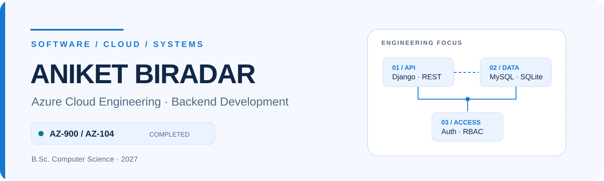
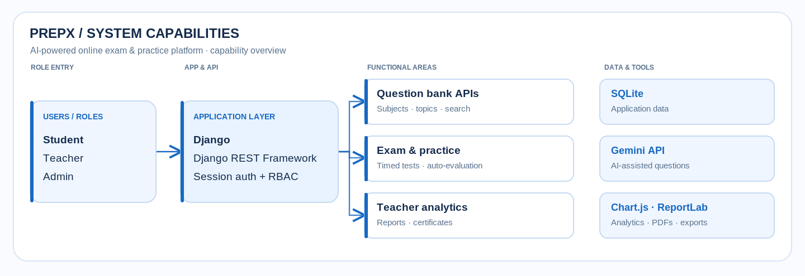
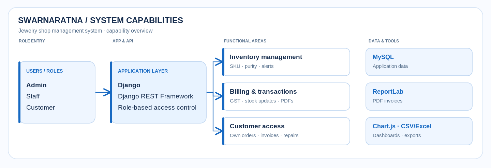

<!--
  GitHub profile README for github.com/aniketbiradar-official
  All referenced local images and draw.io sources are included in this package.
  The diagrams summarize stated capabilities; they are not infrastructure deployment diagrams.
-->

  <picture>
    <source media="(prefers-color-scheme: dark)" srcset="./assets/hero-dark.svg">
    <source media="(prefers-color-scheme: light)" srcset="./assets/hero-light.svg">
    
  </picture>

  

    <a href="https://aniketbiradar.site/">Portfolio</a> &nbsp;·&nbsp;
    <a href="https://www.linkedin.com/in/aniket-biradar-a6b775371/">LinkedIn</a> &nbsp;·&nbsp;
    <a href="https://github.com/aniketbiradar-official">GitHub</a> &nbsp;·&nbsp;
    <a href="mailto:aniketbiradar.official@gmail.com">Email</a>
  

  
Software engineering with an interest in cloud systems, backend applications, access control, and data-driven workflows.

---

## 01 / About

I'm **Aniket Biradar**, a B.Sc. Computer Science student (Class of 2027) interested in **Azure Cloud Engineering** and **Backend Development**. I work on Python- and Java-based software projects and enjoy understanding the systems behind application features: APIs, authentication, authorization, persistence, and reporting.

<table>
  <tr>
    <td width="50%" valign="top">
      <h3>Focus</h3>
      
Cloud engineering and Azure administration

      
Backend applications and REST APIs

      
Role-based access and session security

      
Data-driven application workflows

    </td>
    <td width="50%" valign="top">
      <h3>Working approach</h3>
      
Learn by building

      
Separate application concerns

      
Validate and protect user actions

      
Document technical decisions

    </td>
  </tr>
</table>

## 02 / Microsoft Certifications

| Certification | Status |
| :-- | :-- |
| **Microsoft Certified: Azure Fundamentals (AZ-900)** | Completed |
| **Microsoft Certified: Azure Administrator Associate (AZ-104)** | Completed |
| **Microsoft Certified: Fabric Data Engineer Associate (DP-700)** | Preparing — not yet certified |

Verification links will be added when available. No credential IDs or verification dates are implied.

## 03 / Technical Stack

The following reflects technologies from my learning and project experience—not a claim of advanced professional proficiency in each one.

<table>
  <tr>
    <td width="50%" valign="top">
      <h4>Programming</h4>
      Python · Java
      <h4>Backend</h4>
      Django
      <h4>Databases</h4>
      MySQL · SQLite
    </td>
    <td width="50%" valign="top">
      <h4>Libraries</h4>
      NumPy · Pandas · Tkinter · PyPDF2
      <h4>Tools</h4>
      Git · GitHub · VS Code · PyCharm · Postman
      <h4>Engineering Concepts</h4>
      REST APIs · OOP
    </td>
  </tr>
</table>

---

## 04 / Featured Engineering Work

These are the **two featured projects**. The diagrams below are editable capability maps, not claims about cloud deployment or production infrastructure.

### 01 — PrepX

**AI-Powered Online Exam & Practice Platform**  
*Team project (3 members)*

**Technology stack:** Python · Django · Django REST Framework · SQLite · Bootstrap · Chart.js · ReportLab · Gemini API

An online examination and practice platform with role-specific access, question bank APIs, AI-assisted learning, configurable assessments, and teacher reporting.

  

Editable diagram: <a href="./diagrams/prepx-capabilities.drawio">PrepX capability map (.drawio)</a>

**Engineering contributions**

- **Identity and access:** Implemented authentication, session management, route protection, and role-based access control (RBAC) for **Student, Teacher, and Admin**.
- **Question bank APIs:** Built Subject, Topic, and Question Bank REST APIs with ownership controls, difficulty levels, validation, search, and filtering.
- **AI-assisted learning:** Integrated the **Gemini API** for AI-assisted question generation and personalized learning recommendations.
- **Practice and exams:** Developed progressive test unlocking, timed exams, auto-save, question randomization, negative marking, and automatic evaluation.
- **Teacher tools and reporting:** Built exam management, **Chart.js** analytics dashboards, **ReportLab** certificate generation, and CSV/Excel exports with Django ORM for data handling.

**Source:** [PrepX-Team / PrepX](https://github.com/PrepX-Team/PrepX)

---

### 02 — SwarnaRatna

**Jewelry Shop Management System**  
*Personal project*

**Technology stack:** Python · Django · Django REST Framework · MySQL · Bootstrap · Chart.js · ReportLab

A web-based jewelry shop management system for inventory, billing, customer access, repair information, and business reporting.

  

Editable diagram: <a href="./diagrams/swarnaratna-capabilities.drawio">SwarnaRatna capability map (.drawio)</a>

**Engineering contributions**

- **Authorization:** Designed RBAC for **Admin, Staff, and Customer** using middleware, decorators, and template-level authorization checks.
- **Inventory:** Built SKU tracking, metal and purity information, stock deduction, low-stock alerts, and soft-delete protection.
- **Billing and APIs:** Developed Django REST Framework endpoints and transaction-based billing with dynamic pricing, GST calculations, automatic stock updates, and **ReportLab** PDF invoices.
- **Customer data isolation:** Restricted customers to their own orders, invoices, and repair information.
- **Transaction security:** Applied `transaction.atomic()`, CSRF protection, session security, and input validation to support data integrity in financial operations.
- **Analytics:** Built sales, inventory, customer, and repair dashboards, CSV/Excel exports, and Django ORM reporting using optimized MySQL queries.

**Source:** [aniketbiradar-official / jewelry-shop-management](https://github.com/aniketbiradar-official/jewelry-shop-management)

---

## 05 / Current Direction

**Azure Cloud Engineering · Backend Development**

I'm continuing to develop hands-on skills in Azure administration and cloud architecture while preparing for **DP-700**. My next GitHub portfolio work will organize Azure-related learning, technical diagrams, and hands-on projects as they are completed.

<!-- Add the azure-cloud-portfolio repository link after that repository has actually been created. -->

  
<b>Build thoughtfully. Document clearly. Keep learning.</b>

  

    <a href="https://aniketbiradar.site/">Portfolio</a> &nbsp;·&nbsp;
    <a href="https://www.linkedin.com/in/aniket-biradar-a6b775371/">Connect on LinkedIn</a>
  

  © Aniket Biradar · GitHub Profile

